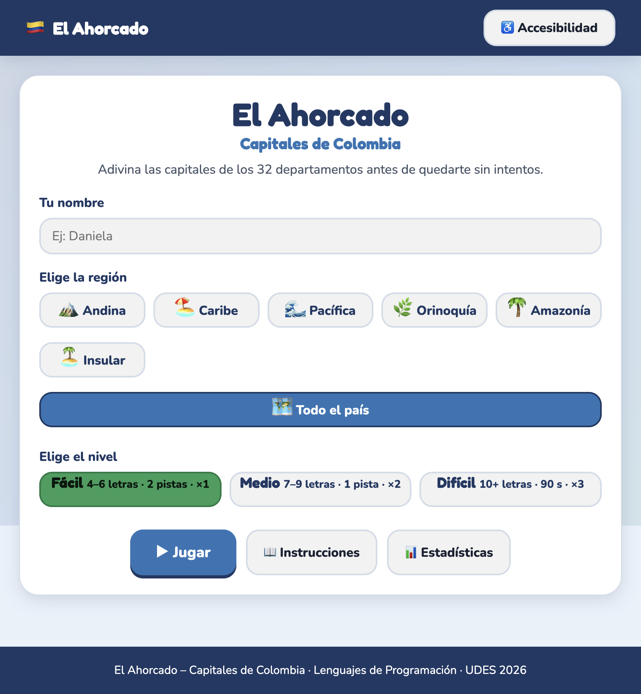
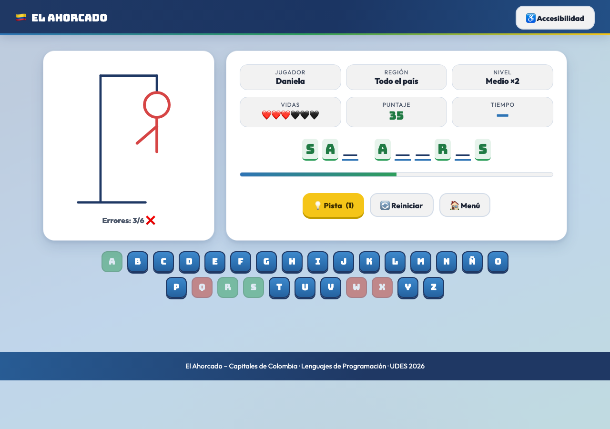
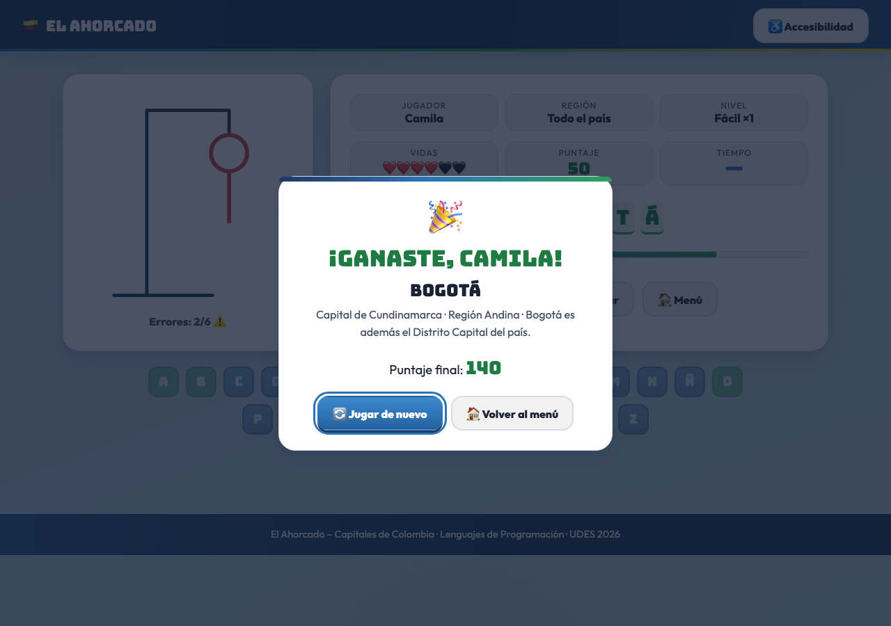
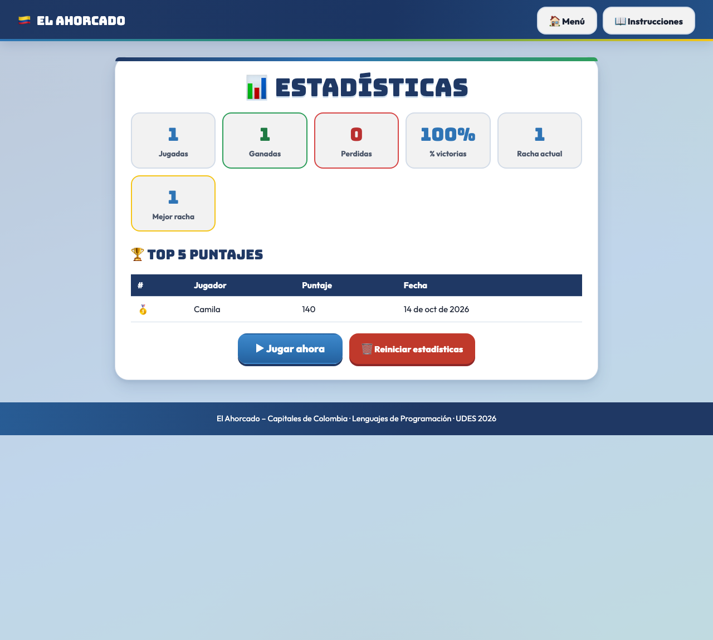
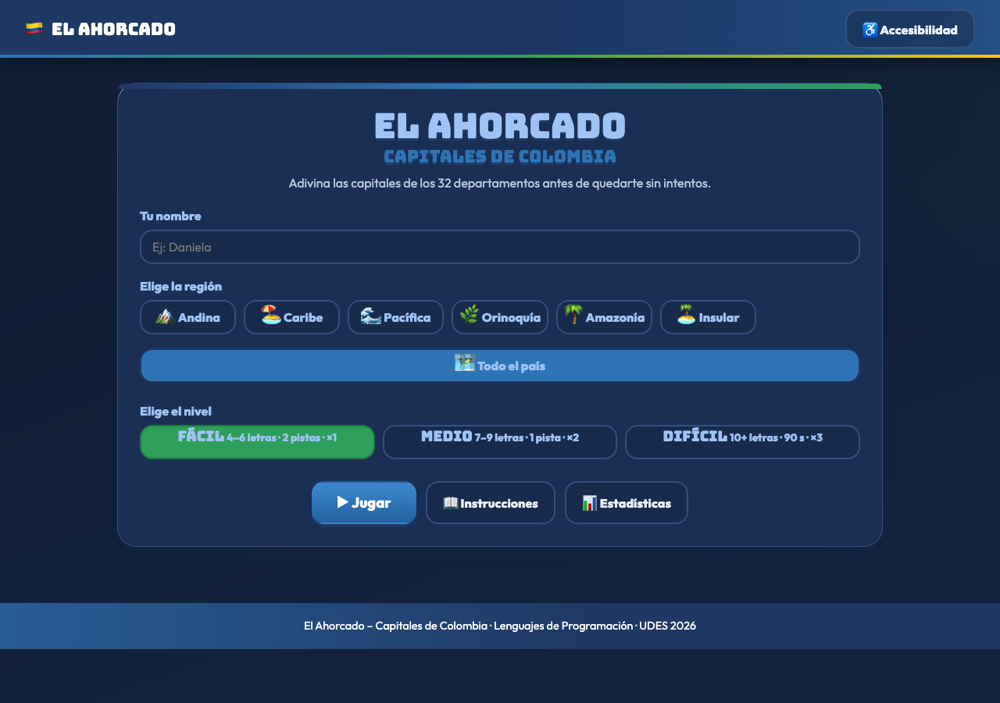

# 🇨🇴 El Ahorcado – Capitales de Colombia

Juego web educativo tipo ahorcado donde el jugador debe adivinar la capital de los departamentos de Colombia antes de agotar los 6 intentos (o los 90 segundos en el nivel Difícil).
Proyecto del **Segundo Parcial de Lenguajes de Programación** – Universidad de Santander (UDES), docente: **Carlos Carrascal**.

## 📖 Descripción

- El jugador ingresa su nombre, elige una **región** (Andina, Caribe, Pacífica, Orinoquía, Amazonía, Insular o Todo el país) y un **nivel** (Fácil, Medio o Difícil).
- Selecciona una capital al azar según la región y el nivel, y la adivina letra a letra con un teclado virtual (A–Z + Ñ) o con el teclado físico.
- Incluye pistas, puntuación en tiempo real con multiplicador por nivel, cronómetro de 90 s en Difícil, estadísticas y ranking con `localStorage`, tema claro/oscuro, sonidos con Web Audio API y un panel de accesibilidad (alto contraste, tamaño de texto, lectura en voz alta y vibración).

## 🛠️ Tecnologías

- **HTML5** semántico (`header`, `main`, `section`, `footer`, `nav`)
- **CSS3**: Flexbox, Grid, variables, media queries y `@keyframes`
- **JavaScript puro (ES6+)**: sin frameworks, sin librerías, sin backend ni base de datos externa
- **localStorage** para estadísticas (`ahorcado_stats`) y preferencias (`ahorcado_config`)
- **Web Audio API** (sonidos) y **Web Speech API** (lectura en voz alta)
- Tipografías Google Fonts: **Fredoka** (títulos) y **Nunito** (cuerpo), con fuentes de respaldo en la pila `font-family`

## ▶️ Cómo ejecutarlo localmente

Opción 1 – Abrir directamente (no requiere instalación ni servidor):

1. Descarga o clona el repositorio.
2. Haz doble clic en `index.html` para abrirlo en tu navegador (Chrome, Firefox, Edge o Safari).

Opción 2 – Con extensión **Live Server** (VS Code):

1. Abre la carpeta `ahorcado-web/` en Visual Studio Code.
2. Instala la extensión **Live Server**.
3. Clic derecho sobre `index.html` → **Open with Live Server**.

Opción 3 – Servidor local con Python:

```bash
python3 -m http.server 8000
# abre http://localhost:8000
```

## 🌐 Despliegue

- **Sitio desplegado en Vercel**: [juegoahorcado10.vercel.app](https://juegoahorcado10.vercel.app/)
- **Repositorio en GitHub**: [github.com/josecanchilag/ahorcado-web](https://github.com/josecanchilag/ahorcado-web)

### Pasos para desplegar en Vercel (sitio estático, sin build)

1. Subida del repositorio a GitHub:
   ```bash
   git remote add origin https://github.com/josecanchilag/ahorcado-web.git
   git push -u origin main
   ```
2. Entra a [vercel.com](https://vercel.com) con tu cuenta de GitHub → **Add New → Project**.
3. Importa el repositorio **ahorcado-web** (Vercel lo detecta como sitio estático: no pedirá framework ni comando de build).
4. Deja **Root Directory** en `/` (la raíz del repo ya contiene `index.html`) y guarda.
5. Pulsa **Deploy**. Al terminar se recibe la URL pública (`https://juegoahorcado10.vercel.app/`).
6. Cada `git push` a `main` vuelve a desplegar automáticamente la versión más reciente.

## 🎥 Video explicativo

- **Video demostración**: próximamente (se enlazará aquí cuando esté publicado).

## 📸 Capturas de pantalla

| Menú principal |
|:---:|
|  |

| Pantalla de juego |
|:---:|
|  |

| Ventana modal de victoria |
|:---:|
|  |

| Estadísticas y ranking |
|:---:|
|  |

| Tema oscuro |
|:---:|
|  |

## 🗂️ Estructura del proyecto

```
ahorcado-web/
  index.html            (pantalla de inicio y juego)
  css/styles.css        (estilos generales: paleta, tipografías y componentes)
  css/responsive.css    (media queries de 360 px a escritorio)
  js/app.js             (punto de entrada, inicializa el juego)
  js/juego.js           (lógica: estado, validación, puntaje, pistas)
  js/palabras.js        (banco de las 32 capitales)
  js/ui.js              (renderizado del DOM y dibujo SVG)
  js/almacenamiento.js  (lectura/escritura en localStorage)
  js/accesibilidad.js   (panel de accesibilidad: contraste, texto, voz, vibración)
  assets/img/           (capturas del proyecto)
  assets/sonidos/       (reservado: los sonidos se generan con Web Audio API)
  pages/instrucciones.html
  pages/estadisticas.html
  pages/estadisticas.js (lógica de la página de estadísticas)
  README.md
```

## 🎮 Reglas del juego

| Nivel | Letras | Pistas | Tiempo | Multiplicador |
|:---:|:---:|:---:|:---:|:---:|
| Fácil | 4 a 6 | 2 | Sin límite | ×1 |
| Medio | 7 a 9 | 1 | Sin límite | ×2 |
| Difícil | 10 o más | 0 | 90 segundos | ×3 |

- Letra correcta **+10** por cada aparición · incorrecta **−5** · cada pista **−15** · ganar **+50 + (vidas restantes × 10)**.
- Puntaje final = subtotal × multiplicador del nivel.
- Las tildes no cuentan (escribir `o` revela la `Ó` de QUIBDÓ) y la **Ñ** es una letra propia (Puerto Carreño).
- Los espacios de las capitales con varias palabras (SANTA MARTA, SAN JOSÉ DEL GUAVIARE…) se muestran desde el inicio y no cuentan como letra.

## ✅ Pruebas

Se ejecutó el plan de pruebas **CP-01 a CP-14** en navegador (Chrome/Firefox/Edge/Safari actuales) y en 360 px: todas **cumplen**. Además se verificó:

- Distribución del banco por código: **12 Fácil, 13 Medio, 7 Difícil = 32 capitales**.
- Contraste WCAG AA de la paleta (ratio ≥ 4.5:1) ajustando solo colores de texto derivados.
- Respuesta por letra: ~13 ms (< 100 ms exigido).
- Consola sin errores en `index.html`, `instrucciones.html` y `estadisticas.html`.

## 🚀 Mejoras futuras (fuera del alcance de esta entrega)

- Multijugador, backend, login, PWA y mapa interactivo avanzado.
- Modo practicar por departamento o cronómetro personalizable.

## 📚 Créditos

- Universidad de Santander (UDES) – Lenguajes de Programación, 2026.
- Docente: Carlos Carrascal.
